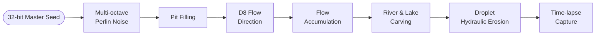

# 🏔️ Procedural Terrain Generation
### Perlin Noise + Hydraulic Erosion for a Living, Evolving Voxel World


-success)

> Minecraft-style worlds are generated once and then frozen forever. This project makes the terrain **age**: same seed, same reproducible world, but one that is carved by rain, rivers and sediment over time.

<!-- EDIT: drop your best hero GIF / time-lapse here -->
<!--  -->


---

## ✨ Highlights

- **Seeded multi-octave Perlin noise** (fractional Brownian motion) for the base landscape
- **Hydrology-driven rivers & lakes** using D8 flow direction, pit filling and flow accumulation in `O(W·H)`
- **Droplet-based hydraulic erosion** (rain → flow → sediment pickup → deposition → evaporation)
- **Fully deterministic**: one 32-bit master seed reproduces the entire world
- **Two run modes**: precompute full erosion offline, or run cheap incremental erosion in a background thread at runtime
- **Time-lapse capture** of terrain evolution, exported to H.264 video

---

## 🎯 The Problem

Standard Perlin-noise terrain is static. Players on the same seed see identical land no matter how much time passes, and nothing in it resembles real geological processes. Prior work on hydraulic erosion (Mei et al., Štava et al.) is mostly aimed at **offline terrain synthesis**, not at **runtime evolution in persistent game worlds**.

This project targets that gap: **deterministic, time-evolving terrain** that stays reproducible while changing in plausible, gameplay-relevant ways.

### Why it matters for gameplay

| Idea | What it enables |
|---|---|
| **Replayability** | Landscapes that evolve reward repeat visits |
| **Geological realism** | Valleys, river channels, depositional formations (with room to grow toward karst, badlands and coastal features) |
| **Emergent mechanics** | River flooding, sinkhole formation, cave expansion |

---

## 🧠 How It Works



Everything runs on a 2D heightmap `H` of size `W × H` cells (world size `W·R × H·R`, where `R` is the cell resolution in metres).

### Stage 1: Base terrain (Perlin fBm)

Several octaves of seeded Perlin noise are summed, then normalised to the target elevation range:

```
height(x, y) = Σ  A(i) · P(x · f(i), y · f(i))      for i = 0 … n-1
A(i) = persistence^i      (default 0.5)
f(i) = lacunarity^i       (default 2.0)
n    = octaves            (default 6–8)
```

An optional independent seeded Perlin mask `M(x, y) ∈ [0, 1]` allows artistic control in later stages.

### Stage 2: Rivers & lakes (hydrology)

1. **D8 flow direction**: each cell flows to its steepest-descent neighbour among 8 (diagonals weighted by √2), encoded as power-of-two flags.
2. **Sink handling**: lightweight pit filling removes single-cell local minima (a common Perlin artefact). This yields flat lake areas and guarantees every cell has a valid downhill path.
3. **Flow accumulation**: counts how many upstream cells drain through each cell.
4. **River identification & carving**: cells above a threshold (default `100`) become channels, width scales logarithmically with accumulation, and the heightmap is carved up to a maximum depth (default `10 m`).

### Stage 3: Hydraulic erosion (droplet model)

Droplets spawn each tick from a seeded RNG (optionally biased toward high ground or existing rivers). Each carries a position, direction, water volume `w` (starts at 1.0) and sediment `s` (starts at 0).

```
capacity = k_c · w · slope

if s < capacity:   erode   → take  min(k_e · (capacity − s), 0.1)  from terrain, add to s
else:              deposit → drop  k_d · (s − capacity)  onto terrain
                   (also deposits when moving uphill)

then:  w *= (1 − evaporation_rate);  lifetime++
```

Direction is smoothed with inertia, and a droplet dies when its water drops below `0.01` or it hits `max_lifetime` (default `300`).

### 🎞️ Time-lapse visualisation

Every *N* erosion iterations the system copies the heightmap, renders to a 1920×1080 texture, overlays metadata (iteration count, parameters), buffers the compressed frame, and finally encodes everything to **H.264**. You get valley formation, river development, sediment deposition and before/after comparisons.

---

## 🔌 API Design

Modular, deterministic and event-driven, built for three audiences:

- **Engine developers** integrating the system into a game engine
- **Game designers** tuning behaviour through exposed parameters and presets
- **Runtime systems** (weather, events, AI) that modify terrain during gameplay

Supports both **offline precomputation** and **incremental runtime simulation**.


<br>
### Fig. 1. Perlin Noise Flowchart <br>
<br>
### Fig. 2. River Generation Flowchart<br>


---

## ⚙️ Parameters

<details>
<summary><b>Perlin noise</b></summary>

| Parameter | Type | Default / Range | Effect |
|---|---|---|---|
| Width / Height | int | 100 | Heightmap dimensions |
| Cell Resolution | int | 1 | Units per cell |
| Scale | float | 5.0 | Level of terrain detail |
| Persistence | float | 0 < p < 1 | How fast amplitude falls per octave |
| Lacunarity | float | > 1 | How fast frequency rises per octave |
| Octaves | int | 6 | Number of layered noise functions |

</details>

<details>
<summary><b>Rivers & lakes</b></summary>

| Parameter | Type | Default | Effect |
|---|---|---|---|
| RiverThreshold | int | 100 | Minimum flow accumulation to become a river |
| RiverWidthBase | float | 1 | Base river width |
| RiverWidthScale | float | 1 | Log-scale factor for width |
| RiverCarveDepthMax | float | 10 | Maximum carving depth |
| UsePitFilling | bool | true | Fill local sinks into lakes |

</details>

<details>
<summary><b>Hydraulic erosion</b></summary>

| Parameter | Type | Default | Effect |
|---|---|---|---|
| Rain Rate | int | 1000 (500–2000) | Droplets per tick |
| Erosion Constant `k_e` | float | 0.7 | Erosion rate |
| Deposition Constant `k_d` | float | 0.08 | Deposition rate |
| Capacity Constant `k_c` | float | 4.0 | Sediment capacity |
| Evaporation Rate | float | 0.02 | Water loss per step |
| Inertia | float | 0.3 | Direction smoothing |
| MaxLifetime | int | 300 | Max steps per droplet |
| StepSize | float | 1.0 | Movement per step |
| Simulation Ticks | int | 10 runtime / 100 generation | Number of erosion ticks |
| BiasSpawnToRivers | bool | false | Spawn droplets near rivers |

</details>

---

## 🧱 Scope & Limitations

- **Platforms:** PC and modern consoles; reference implementation in **Unity (C#)** using a heightmap or low-resolution voxel grid
- **Goal is plausibility, not geological accuracy**: visually and mechanically believable behaviour for gameplay
- **Performance:** full erosion can be precomputed offline, or run incrementally and cheaply at runtime

---

## 🚀 Getting Started

<!-- EDIT: add Unity version, clone instructions, how to open the scene, how to set a seed and press Generate. -->

---

## 📚 Key References

- Perlin, K. (1985). *An image synthesizer.* ACM SIGGRAPH CGA, 19(3).
- Perlin, K. (2002). *Improving noise.* ACM TOG, 21(3).
- Musgrave, Kolb & Mace (1989). *The synthesis and rendering of eroded fractal terrains.* SIGGRAPH.
- Mei, Decaudin & Hu (2007). *Fast hydraulic erosion simulation and visualization on GPU.* Pacific Graphics.
- Štava, Beneš, Brisbin & Křivánek (2008). *Interactive terrain modeling using hydraulic erosion.* SCA.
- Génevaux et al. (2013). *Terrain generation using procedural models based on hydrology.* ACM TOG, 32(4).
- Cordonnier et al. (2016). *Large scale terrain generation from tectonic uplift and fluvial erosion.* Computer Graphics Forum, 35(2).

Full list in the project proposal.

---

## 👥 Team

Bachelor of Computer Science (Honours) in Interactive Software Technology, Tunku Abdul Rahman University of Management and Technology, Kuala Lumpur, Malaysia.

- **Cheah Hong Lek**
- **Jonathan Wong Rong Wei**
- **Soi Hui Fang**

---

## 📄 License

<!-- EDIT: e.g. MIT -->
